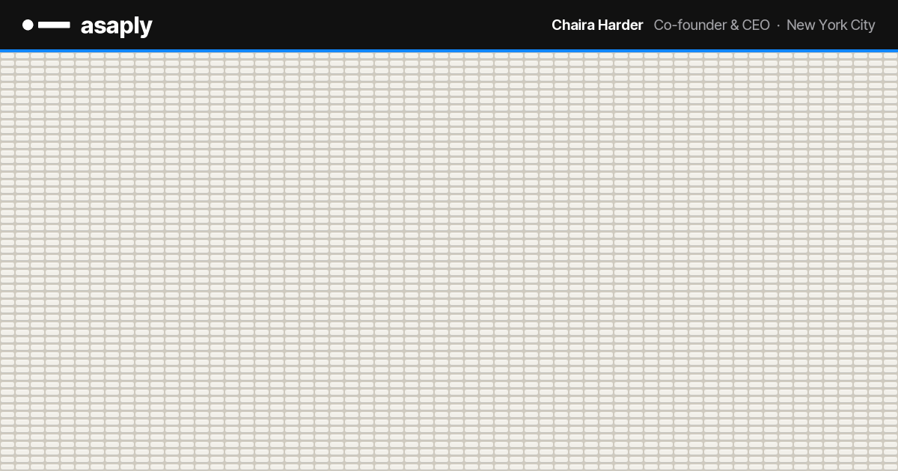

# Chaira Harder

**Co-founder & CEO, [Asaply](https://asaply.ai/) · New York City**

Building a text-first AI marketplace that helps people discover and order from local businesses.

[Asaply](https://asaply.ai/) &nbsp; / &nbsp; [About me](https://chairaharder.com/) &nbsp; / &nbsp; [LinkedIn](https://www.linkedin.com/in/chaira-harder/) &nbsp; / &nbsp; [Instagram](https://www.instagram.com/asaply.ai/)

The future takes the subway.

